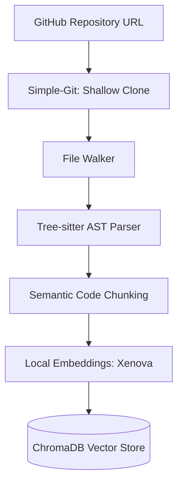
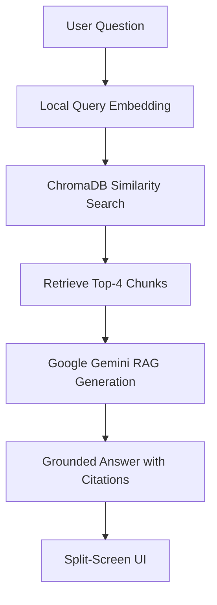

# CodeSense ⚡
### Intelligent Codebase Onboarding Agent

A full-stack, context-aware AI assistant that ingests public GitHub repositories, parses code structurally using **Abstract Syntax Trees (AST)**, and enables developers to explore and ask natural-language questions about codebases with exact code citations.

---

## 🌟 Key Features

- 🌳 **AST Semantic Chunking (Tree-sitter)**
  - Extracts complete, syntactically intact functions, classes, and arrow functions.
  - Preserves exact start and end line numbers.
  - Supports JavaScript, TypeScript, TSX, and Python.

- 🧠 **100% Free & Local Embeddings**
  - Uses `@xenova/transformers`.
  - Runs `Xenova/all-MiniLM-L6-v2` locally through ONNX Runtime.
  - Generates 384-dimensional dense vectors on your CPU.
  - Zero embedding API cost and improved code privacy.

- 🗄️ **Local Vector Database (ChromaDB)**
  - Stores code chunks and their embeddings.
  - Uses HNSW graph indexing.
  - Performs cosine similarity-based semantic search.

- 🤖 **Grounded RAG (Google Gemini)**
  - Generates concise explanations based on retrieved code chunks.
  - Provides precise file paths and line-number citations.
  - Reduces unsupported answers through retrieval-grounded generation.

- 🖥️ **Split-Screen Developer Interface**
  - **Left Panel:** Conversational AI chat with Markdown support and collapsible code citations.
  - **Right Panel:** Embedded Monaco Editor with syntax highlighting.
  - **Draggable Resizer:** Allows developers to adjust panel widths.

---

## 🏗️ System Architecture

CodeSense follows a Retrieval-Augmented Generation (RAG) architecture with local embeddings and a vector database.

### Repository Ingestion Pipeline



### Question Answering Pipeline



---

## 🛠️ Tech Stack

| Layer | Technologies |
|---|---|
| Frontend | React 18, Vite, Tailwind CSS |
| Code Editor | Monaco Editor |
| UI Libraries | lucide-react, react-markdown |
| Backend | Node.js (ESM), Express.js |
| AST Parser | Tree-sitter |
| Parser Grammars | tree-sitter-javascript, tree-sitter-typescript, tree-sitter-python |
| Embeddings | @xenova/transformers |
| Embedding Model | Xenova/all-MiniLM-L6-v2 |
| Vector Database | ChromaDB |
| LLM | Google Gemini |
| Git Operations | simple-git |

---

## 🚀 Getting Started

Follow these steps to run CodeSense locally.

### 1. Prerequisites

Make sure you have installed:

- [Node.js](https://nodejs.org/) (v20+ recommended)
- [Python](https://www.python.org/) (3.8+)
- [Git](https://git-scm.com/)
- A free [Google Gemini API Key](https://aistudio.google.com/app/apikey)

### 2. Clone the Repository

```bash
git clone https://github.com/Shivansh-star/code-sense.git

cd code-sense
```

### 3. Install Dependencies

**Backend Dependencies**

```bash
cd backend

npm install --legacy-peer-deps
```

**Frontend Dependencies**

```bash
cd ../frontend

npm install
```

### 4. Configure Environment Variables

Create a `.env` file inside the `backend/` directory.

```env
GEMINI_API_KEY=your_actual_gemini_api_key_here

PORT=3001

CHROMA_HOST=http://localhost:8000

CLONE_DIR=./tmp/repos
```

**Important:** Never commit your `.env` file or expose your API keys publicly.

Add `.env` to your `.gitignore` file.

### 5. Run the Application

Open **three separate terminals** in your project root directory.

**Terminal 1: Start ChromaDB**

```bash
python run-chroma.py
```

ChromaDB will run at:

`http://localhost:8000`

**Terminal 2: Start Backend Server**

```bash
cd backend

npm start
```

Express backend will run at:

`http://localhost:3001`

**Terminal 3: Start Frontend**

```bash
cd frontend

npm run dev
```

Vite frontend will run at:

`http://localhost:5173`

### 6. Open CodeSense

Visit:

**http://localhost:5173**

1. Paste any public GitHub repository URL into the input field.
2. Click **Ingest Repo**.
3. CodeSense clones and parses the repository using Tree-sitter.
4. Local embeddings are generated and stored in ChromaDB.
5. Ask natural-language questions about the repository.
6. Click any cited code snippet to view the exact code in Monaco Editor.

---

## 📂 Project Structure

```text
code-sense/
│
├── run-chroma.py
├── README.md
│
├── backend/
│   ├── server.js
│   ├── .env
│   │
│   ├── routes/
│   │   ├── ingest.route.js
│   │   └── chat.route.js
│   │
│   ├── services/
│   │   ├── parser.service.js
│   │   ├── parser.ts-loader.js
│   │   ├── embedding.service.js
│   │   ├── vectorstore.service.js
│   │   └── llm.service.js
│   │
│   ├── utils/
│   │   └── fileWalker.js
│   │
│   └── scripts/
│       └── inspect-embeddings.js
│
└── frontend/
    ├── index.html
    ├── vite.config.js
    ├── tailwind.config.js
    │
    └── src/
        ├── main.jsx
        ├── App.jsx
        ├── api.js
        │
        ├── hooks/
        │   └── useCodeSense.js
        │
        └── components/
            ├── IngestPanel.jsx
            ├── ChatPanel.jsx
            ├── ChatMessage.jsx
            └── CodeViewer.jsx
```

---

## 🔌 API Reference

### 1. Ingest Repository

**Endpoint:** `POST /api/ingest`

Ingests a GitHub repository, parses its source files into AST-based chunks, generates local embeddings, and stores them in ChromaDB.

**Request Body**

```json
{
  "repoUrl": "https://github.com/owner/repository"
}
```

**Response**

```json
{
  "message": "Repository ingested successfully.",
  "repoUrl": "https://github.com/owner/repository",
  "filesProcessed": 13,
  "chunksIndexed": 12
}
```

### 2. Chat with Codebase

**Endpoint:** `POST /api/chat`

Answers natural-language questions about the ingested repository using retrieved code chunks.

**Request Body**

```json
{
  "question": "Where is the authentication middleware located?"
}
```

**Response**

```json
{
  "llm_response": "The authentication middleware is defined in src/middleware/auth.js...",
  "cited_code_snippets": [
    {
      "id": "src/middleware/auth.js::verifyToken::12",
      "code": "function verifyToken(req, res, next) { ... }",
      "filePath": "src/middleware/auth.js",
      "functionName": "verifyToken",
      "nodeType": "function_declaration",
      "startLine": 12,
      "endLine": 28,
      "relevanceScore": 0.9142
    }
  ]
}
```

---

## 🔒 Privacy & Cost Efficiency

- **Zero Embedding API Cost:** Embeddings are generated locally using `@xenova/transformers` and ONNX Runtime.
- **Code Privacy:** Repository files are parsed and deleted from disk after vectorization, according to the implemented ingestion workflow.
- **Local Vector Storage:** Embeddings and metadata are stored in a locally running ChromaDB instance.
- **Free-Tier LLM:** Uses Google Gemini's free-tier API quota for answer generation.

---

## 🎯 Use Cases

- Understanding unfamiliar GitHub repositories.
- Exploring large codebases without manually reading every file.
- Finding specific functions, classes, and implementations.
- Understanding code dependencies and functionality.
- Onboarding new developers to existing projects.
- Getting code explanations with exact source references.

---

## 📄 License

This project is open-source and available under the **MIT License**. See the [LICENSE](LICENSE) file for details.
