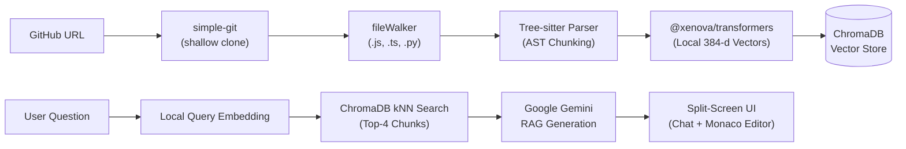

# CodeSense ⚡ Intelligent Codebase Onboarding Agent

> A full-stack, context-aware AI assistant that ingests public GitHub repositories, parses code structurally using Abstract Syntax Trees (AST), and allows developers to explore and ask natural language questions with exact code citations.

---

## 🌟 Key Features

- 🌳 **AST Semantic Chunking (Tree-sitter):** Never slices code mid-statement. Extracts complete, syntactically intact `function`, `class`, and `arrow_function` blocks with exact start/end line numbers. Supports **JavaScript**, **TypeScript**, **TSX**, and **Python**.
- 🧠 **100% Free & Local Embeddings:** Uses `@xenova/transformers` running `Xenova/all-MiniLM-L6-v2` inside Node.js via ONNX Runtime. Generates 384-dimensional dense vectors locally on your CPU with **zero API cost** and **complete code privacy**.
- 🗄️ **Local Vector Database (ChromaDB):** Stores chunks and vectors with **HNSW graph indexing** and **cosine similarity search** for sub-5ms retrieval.
- 🤖 **Grounded RAG (Gemini 3.5 Flash):** Generates concise explanations grounded strictly in the retrieved code chunks, citing precise file paths and line numbers.
- 🖥️ **Split-Screen Developer UI:**
  - **Left Panel:** Conversational chat interface with markdown formatting and collapsible cited-snippet badges.
  - **Right Panel:** Embedded **Monaco Editor** (the engine behind VS Code) displaying the exact cited code block with auto-detected syntax highlighting.
  - **Draggable Resizer:** Adjustable split-pane width.

---

## 🏗️ Architecture



---

## 🛠️ Tech Stack

| Layer | Technologies |
|---|---|
| **Frontend** | React 18, Vite, Tailwind CSS, `@monaco-editor/react`, `lucide-react`, `react-markdown` |
| **Backend** | Node.js (ESM), Express.js, `cors`, `dotenv` |
| **AST Parser** | `tree-sitter`, `tree-sitter-javascript`, `tree-sitter-typescript`, `tree-sitter-python` |
| **Embeddings** | `@xenova/transformers` (`Xenova/all-MiniLM-L6-v2` — 100% local CPU) |
| **Vector Database** | ChromaDB (`chromadb` local server on port 8000) |
| **LLM Engine** | `@google/generative-ai` (`gemini-3.5-flash-lite` / `gemini-3.8-flash`) |
| **Git Operations** | `simple-git` |

---

## 🚀 Quick Start Guide

### 1. Prerequisites
Ensure you have installed:
- [Node.js](https://nodejs.org/) (v20+ recommended)
- [Python](https://www.python.org/) (3.8+)
- [Git](https://git-scm.com/)
- A free **Google Gemini API Key** from [Google AI Studio](https://aistudio.google.com/app/apikey)

---

### 2. Installation

Clone this repository and install dependencies for both backend and frontend:

```powershell
# 1. Install Backend Dependencies
cd backend
npm install --legacy-peer-deps

# 2. Install Frontend Dependencies
cd ../frontend
npm install
```

---

### 3. Configure Environment Variables

In the `backend/` folder, create a `.env` file (or copy from `.env.example`):

```env
# backend/.env
GEMINI_API_KEY=your_actual_gemini_api_key_here
PORT=3001
CHROMA_HOST=http://localhost:8000
CLONE_DIR=./tmp/repos
```

---

### 4. Running the Project

Open **3 terminal windows** in the project root:

#### 🟢 Terminal 1: Start ChromaDB (Vector Store)
```powershell
python run-chroma.py
```
> *Runs ChromaDB server on `http://localhost:8000`.*

#### 🟢 Terminal 2: Start Backend Server
```powershell
cd backend
npm start
```
> *Runs Express API on `http://localhost:3001`.*

#### 🟢 Terminal 3: Start Frontend Client
```powershell
cd frontend
npm run dev
```
> *Runs Vite development server on `http://localhost:5173`.*

---

### 5. Open in Your Browser
Visit: **`http://localhost:5173`**

1. Paste any public GitHub repository link (e.g. `https://github.com/expressjs/express`) into the top bar.
2. Click **Ingest Repo** — CodeSense will clone, parse with Tree-sitter, generate local embeddings, and index the code in ChromaDB.
3. Ask technical questions in the chat! Click any cited code snippet to view it in Monaco Editor on the right.

---

## 📂 Project Structure

```
gen_ai_proj/
├── run-chroma.py                  # Standalone ChromaDB launcher
├── README.md                      # Project documentation
│
├── backend/                       # Express.js REST API
│   ├── server.js                  # Main server entry point
│   ├── .env                       # Secrets (API Keys)
│   ├── routes/
│   │   ├── ingest.route.js        # POST /api/ingest & GET /api/ingest/status
│   │   └── chat.route.js          # POST /api/chat
│   ├── services/
│   │   ├── parser.service.js      # Tree-sitter AST chunker
│   │   ├── parser.ts-loader.js    # TypeScript / TSX grammar loader
│   │   ├── embedding.service.js   # Xenova / all-MiniLM-L6-v2 local embeddings
│   │   ├── vectorstore.service.js # ChromaDB client & similarity search
│   │   └── llm.service.js         # Google Gemini RAG generation
│   ├── utils/
│   │   └── fileWalker.js          # Recursive source file finder
│   └── scripts/
│       └── inspect-embeddings.js  # CLI tool to inspect 384-d vectors
│
└── frontend/                      # React.js (Vite) Single Page App
    ├── index.html                 # App shell
    ├── vite.config.js             # Dev server & /api proxy
    ├── tailwind.config.js         # Dark mode theme styling
    └── src/
        ├── main.jsx               # React entry point
        ├── App.jsx                # Root layout with resizable split-pane
        ├── api.js                 # Axios API client
        ├── hooks/
        │   └── useCodeSense.js    # Central state machine
        └── components/
            ├── IngestPanel.jsx    # GitHub URL input & live status
            ├── ChatPanel.jsx      # Message history & input bar
            ├── ChatMessage.jsx    # Markdown messages & cited snippets
            └── CodeViewer.jsx     # Monaco Editor code viewer
```

---

## 🔌 API Reference

### `POST /api/ingest`
Ingests a GitHub repository, parses files into AST chunks, and stores local embeddings.
- **Request:**
  ```json
  { "repoUrl": "https://github.com/owner/repository" }
  ```
- **Response:**
  ```json
  {
    "message": "Repository ingested successfully.",
    "repoUrl": "https://github.com/owner/repository",
    "filesProcessed": 13,
    "chunksIndexed": 12
  }
  ```

### `POST /api/chat`
Answers a natural language question about the ingested codebase.
- **Request:**
  ```json
  { "question": "Where is the authentication middleware located?" }
  ```
- **Response:**
  ```json
  {
    "llm_response": "The authentication middleware is defined in `src/middleware/auth.js`...",
    "cited_code_snippets": [
      {
        "id": "src/middleware/auth.js::verifyToken::12",
        "code": "function verifyToken(req, res, next) { ... }",
        "filePath": "src/middleware/auth.js",
        "functionName": "verifyToken",
        "nodeType": "function_declaration",
        "startLine": 12,
        "endLine": 28,
        "relevanceScore": 0.9142
      }
    ]
  }
  ```

---

## 🔒 Privacy & Cost Efficiency

- **Zero Embedding Cost:** Embeddings are generated locally using `@xenova/transformers` ONNX models inside Node.js.
- **Code Privacy:** Cloned repository files are parsed and **immediately deleted from disk** after vectorization. Only mathematical vector representations and metadata are persisted in ChromaDB.
- **Free-Tier LLM:** Uses Google Gemini's generous free-tier quota for answer synthesis.

---

## 📄 License
This project is open-source and available under the [MIT License](LICENSE).
